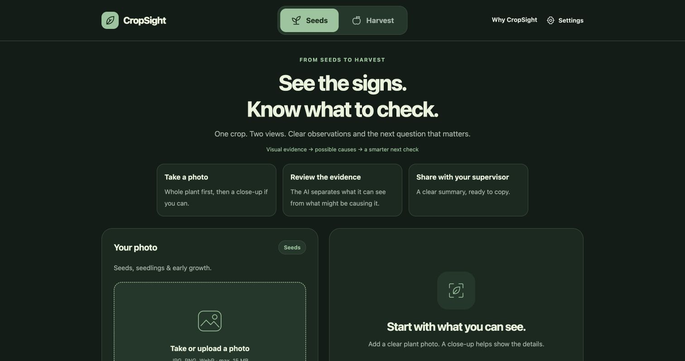
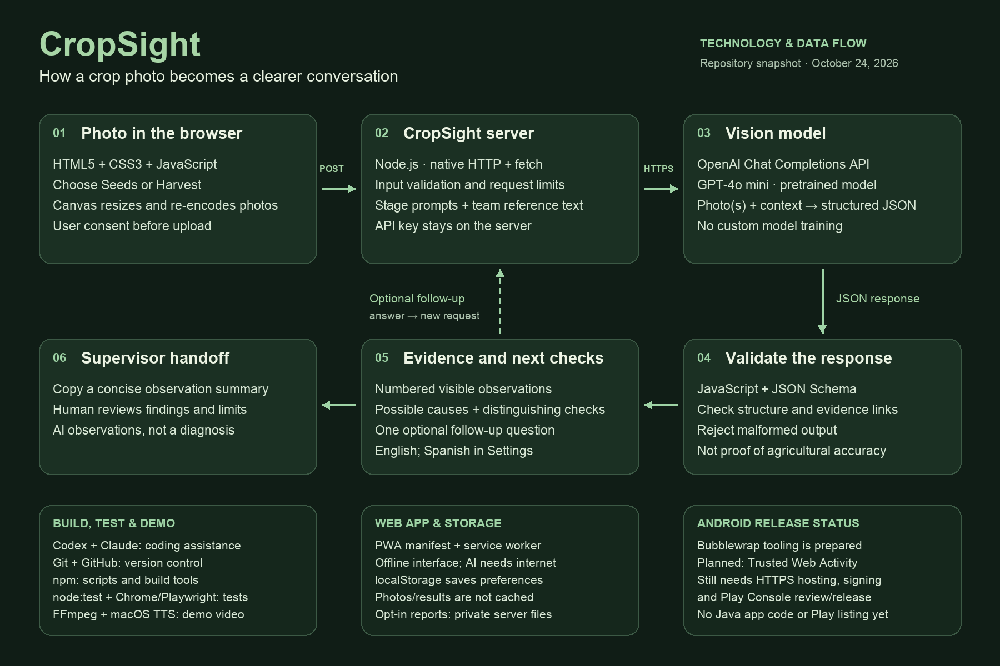

# CropSight

**See the signs. Know what to check.**

A crop-photo assistant built for Sierra Hacks 2026. CropSight helps farmworkers describe unfamiliar crop conditions and share clear observations with a supervisor.

[Quick start](#quick-start) · [How it works](#how-it-works) · [Architecture](#architecture) · [Screenshots](screenshots/README.md) · [Demo video](demo/README.md) · [Android release guide](release/PLAY-STORE.md)



## What it does

- **Seeds or Harvest:** choose the stage you are observing.
- **Photo-first workflow:** add an overview and an optional close-up of the same plant.
- **Evidence and next checks:** review numbered model observations, possible explanations and a useful follow-up question when available.
- **Supervisor handoff:** copy a concise summary that includes the limits of the assessment.
- **English-first interface:** Spanish and installation options are in Settings.

CropSight is an **experimental observation tool**, not a disease diagnosis or permission to harvest or treat a crop. Live tests have exposed incorrect reassuring verdicts; the revised prompts still need live verification. Software tests do not measure agricultural accuracy. [Validation details and known limitations →](docs/TECHNICAL.md#validation-status)

## Quick start

You need **Node.js 20+** and an OpenAI API key for photo analysis. The web server has no external runtime dependencies.

```sh
git clone https://github.com/aarizryaz-hue/crop-sightAI.git
cd crop-sightAI
cp .env.example .env
```

Open `.env` locally and set `OPENAI_API_KEY`. Keep the key in that file or your server environment; `.env` is excluded from Git.

```sh
npm start
```

Open **http://127.0.0.1:3000**. Without a key, the interface opens but AI analysis is unavailable. Restart the Node server after backend changes; refreshing the browser only reloads the page.

```sh
npm test
```

The 37 automated tests use mocked provider responses and require no API key. For configuration, alternate providers, privacy and deployment, see the [technical guide](docs/TECHNICAL.md).

## How it works

1. The browser resizes the selected photos and asks for consent before sending them.
2. A Node.js server validates the request and calls **OpenAI GPT-4o mini** with stage-specific instructions.
3. The model returns structured observations, possible causes and a follow-up question when useful.
4. The server checks the response structure and evidence references before displaying the result.
5. The worker can answer the follow-up and copy a summary for human review.

The API key stays on the server. CropSight uses a pretrained model; it does not train a new model. Its guides are team-written comparison context, not a validated training dataset.

## Architecture



[Full-resolution diagram](docs/cropsight-architecture.png) · [Editable SVG](docs/cropsight-architecture.svg)

| Layer | Technology |
| --- | --- |
| Interface | HTML5, CSS3, vanilla JavaScript |
| Browser features | Canvas, Fetch, Clipboard and localStorage |
| Backend | Node.js built-in HTTP server and native fetch |
| AI | OpenAI Chat Completions API, GPT-4o mini, JSON Schema |
| Installation | PWA manifest, service worker and offline interface cache |
| Quality checks | Node test runner, Chrome and Playwright |
| Development | npm, Git, GitHub; coding assistance from Codex and Claude |
| Android preparation | Bubblewrap / Trusted Web Activity tooling |

## Explore the project

| Location | Contents |
| --- | --- |
| [`index.html`](index.html) | Interface, styling and browser behavior |
| [`server.js`](server.js), [`analysis.js`](analysis.js), [`webapp.js`](webapp.js) | API calls, validation, app assets, privacy and reports |
| [`public/`](public/) | Install manifest, service worker and app icons |
| [`references/`](references/) | Team-written crop/seed guides and optional reference-photo configuration |
| [`test/`](test/) | Automated software tests |
| [`docs/`](docs/README.md) | Technical guide, architecture diagram and development history |
| [`screenshots/`](screenshots/README.md) | Screenshots of the running interface |
| [`demo/`](demo/README.md) | Narrated review video, captions, source assets and live-test notes |
| [`scripts/`](scripts/) and [`release/`](release/PLAY-STORE.md) | Android preparation scripts and publishing checklist |
| [`archive/`](archive/README.md) | Original ZIP upload, retained for historical reference |

## Demo and release status

The [60-second video](demo/CropSight-demo.mp4) is a **review cut** with real API output. It explicitly shows a model error and labels shortened waiting time. Read the [recording notes](demo/README.md) before using it in a presentation.

The installable web interface can open offline; **AI analysis needs internet**. Android packaging scripts and listing materials are prepared, but **no APK/AAB has been built and no Google Play release has been published**. A public HTTPS deployment and publisher setup are still required. [Android release guide →](release/PLAY-STORE.md)

## Research and credits

The idea is informed by UC Agriculture and Natural Resources' farmworker learning-needs research. Those findings motivate the project; they do not validate this app or imply endorsement. [Research sources and credits →](docs/TECHNICAL.md#research-and-credits)

Built with assistance from **OpenAI Codex and Claude**. The runtime photo analysis uses **OpenAI's API**. Third-party demo-photo credits and licensing are documented in the [demo notes](demo/README.md).
