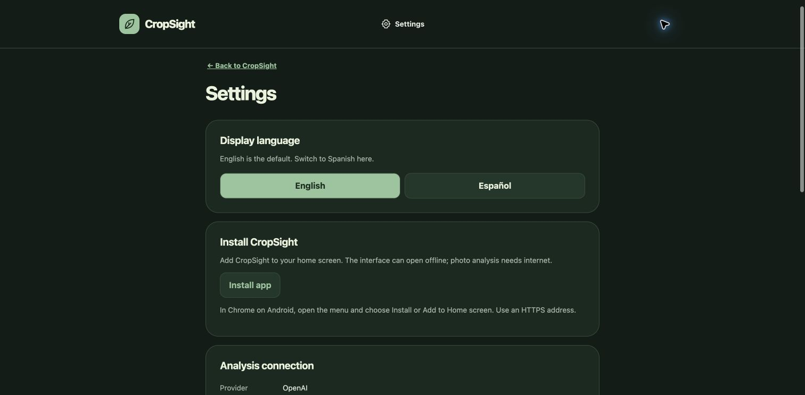

# CropSight screenshots

Captured from the running local app on October 24, 2026, in Chrome. These are direct browser screenshots, not mockups.

- **Home:** English-first landing screen, Seeds/Harvest navigation, and the three-step workflow.
- **Settings:** display language, installation options, and AI connection information.

The running server reported `cropsight-android-4`. These screenshots document the visible interface, not agricultural accuracy or verification of the newer analysis instructions. No Play Store availability is claimed.

Suggested Devpost captions:

1. “CropSight: turn crop photos into observations for a conversation with your supervisor.”
2. “English by default, with Spanish and installation options in Settings.”

The architecture diagram is available in [`../docs/cropsight-architecture.png`](../docs/cropsight-architecture.png), with an editable SVG alongside it.

